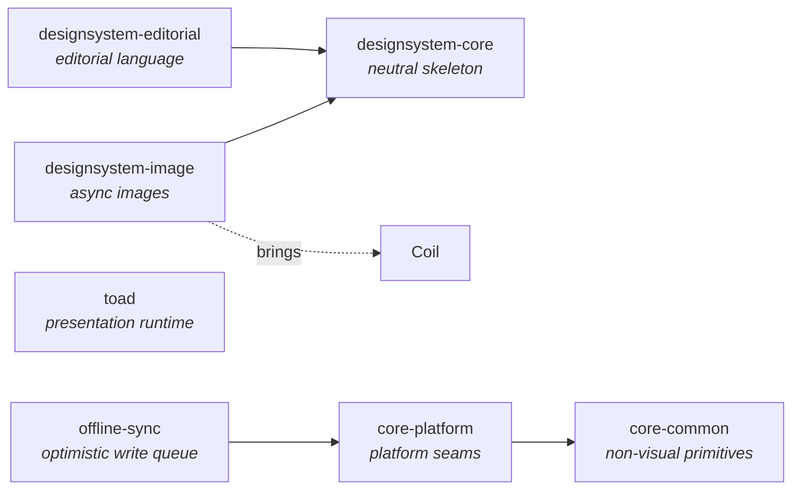

<div align="center">

# rhaydus-foundation

**A shared backbone for Kotlin Multiplatform apps: KMP libraries, build tooling, conventions, and the Claude Code assets that teach an AI assistant how to use them.**


</div>

---

## Why this exists

Ship more than one Kotlin Multiplatform app on the same stack and the shared parts quietly drift: the same TOAD presentation runtime, the same Compose design language, the same ktlint rules and Gradle conventions, duplicated and slowly diverging. `rhaydus-foundation` is the single, **versioned** home for everything they share, so a fix or an improvement lands once and every consuming app inherits it.

It ships three things most "shared module" repos don't bother to keep together:

- 📦 **KMP libraries**: consumed as a git submodule through `includeBuild`, opt-in by concern.
- 🧰 **Build + style tooling**: Gradle convention plugins, a shared version catalog file, and a custom ktlint ruleset.
- 🤖 **Claude Code assets**: a plugin of specialist agents, a skill, and a docs index, so an AI assistant working in a consuming app *knows what's available and is steered to actually use it*.

---

## What's inside

### Libraries (`nl.rhaydus:*`, version `0.4.0`)

| Module | Coordinate | What it gives you |
|---|---|---|
| **TOAD runtime** | `nl.rhaydus:toad` | The home-grown MVI-style presentation framework: `ToadScreenModel`, `UiState`/`UiAction`/`UiEvent`, `Collector`, `ActionScope`. |
| **Core common** | `nl.rhaydus:core-common` | Non-visual shared primitives: `AppDispatchers`, the `AppLog` logging facade, `runCatchingCancellable` / `runCatchingLogged`, date/time/number formatting. |
| **Core platform** | `nl.rhaydus:core-platform` | Platform-capability seams (depends on core-common): `SecureStorage` and `NetworkAvailabilityProvider`, each with Android / iOS / desktop implementations. |
| **Offline sync** | `nl.rhaydus:offline-sync` | Offline optimistic-write queue skeleton (depends on core-platform): `WriteQueue` / `PendingWriteStore`, `OfflineWriteDrainer`, `PendingWrite`, `ReplayOutcome`, `DrainPolicy` - the app supplies the persistence seam. |
| **Design system: core** | `nl.rhaydus:designsystem-core` | The **design-agnostic** Compose skeleton: theme scaffold, layout primitives (window-size classes, two-pane, content-width caps), modifiers, motion + reduced-motion seam, haptics, the button family. |
| **Design system: editorial** | `nl.rhaydus:designsystem-editorial` | **Opt-in** editorial design language: shared type-role contract + components (section header, hero stat, drop cap, search field, pull-to-refresh eyebrow). |
| **Design system: image** | `nl.rhaydus:designsystem-image` | **Opt-in** async images on Coil: plain, placeholder, and shimmer variants. |
| **ktlint rules** | `nl.rhaydus:ktlint-rules` | 11 auto-fixing layout rules: one-per-line arg wrapping, trailing-lambda braces, multi-line expressions opening on the `=` line, trailing commas, statement paragraphs, brace and sibling-composable blank lines, region flushing, boolean `.not()`, unused imports, and the import layout; plus ktlint's standard indentation rule. |
| **detekt rules** | `nl.rhaydus:detekt-rules` | Custom detekt ruleset for call sites and function bodies (unguarded `Flow.first()` / `single()`, reflection by name, raw dp in spacing and corners, raw logging, inline mockk stubs, Arrange / Act / Assert markers, and more) plus the shared detekt baseline config every app builds on. |
| **Konsist rules** | `nl.rhaydus:konsist-rules` | Konsist assertions for declarations and architecture: import bans with per-file allowlists, layering, one type per file, `@Nested` tests, Screen arguments that survive serialization, and UI models built in `UiState` getters. |

### Tooling

- **Gradle convention plugins** (`build-logic/`): `rhaydus.android.library`, `rhaydus.kmp.library`, `rhaydus.android.compose`, `rhaydus.kmp.compose`, for uniform module setup (SDK/JDK levels, the Android+iOS `mobileMain` seam, the test stack, Compose).
- **Canonical conventions docs** (`docs/`): see [`CAPABILITIES.md`](docs/CAPABILITIES.md) (the index of everything available), plus architecture, TOAD, code-style, and design-system foundations.

### Module graph



An app that wants a different look depends on `designsystem-core` alone and never pulls the editorial language or Coil; the opinionated layers are opt-in by design.

---

## Quick start

### 1. Add the submodule and `includeBuild`

```bash
git submodule add https://github.com/CinqueIzumi/rhaydus-foundation.git foundation
git -C foundation checkout v0.4.0
```

```kotlin
// settings.gradle.kts
includeBuild("foundation")
```

```kotlin
// build.gradle.kts
dependencies {
    implementation("nl.rhaydus:toad")
    implementation("nl.rhaydus:designsystem-core")
    implementation("nl.rhaydus:designsystem-editorial") // opt-in
    implementation("nl.rhaydus:designsystem-image")     // opt-in (pulls Coil)
}
```

Gradle substitutes the `nl.rhaydus:*` coordinates for the submodule source, so the catalog entries carry no version. The app builds on the same AGP and Kotlin versions as the pinned foundation. CI checkouts that run Gradle set `submodules: true`, and clones use `--recurse-submodules`. Nothing is published: the submodule is the only way to consume the foundation.

<details>
<summary><b>Optional: shared version catalog and convention plugins</b></summary>

```kotlin
// settings.gradle.kts
pluginManagement {
    includeBuild("foundation/build-logic")
}

dependencyResolutionManagement {
    versionCatalogs {
        create("rhaydus") { from(files("foundation/gradle/libs.versions.toml")) }
    }
}
```
App-only libraries (Apollo, Room, etc.) stay in your app's own catalog.
</details>

### 2. Develop against the foundation source

Edit `foundation/` on a branch; the app builds the change directly, with no version bump. Commit in the foundation first, then record the new pointer in the app with `git add foundation`. A foundation version change moves the pointer: fetch in `foundation/`, check out the new tag, `git add foundation`, commit.

### 3. Load the Claude Code plugin

Add this to the project's `.claude/settings.json`, or run `rhaydus-adopt`:

```json
{
  "extraKnownMarketplaces": {
    "rhaydus": { "source": { "source": "directory", "path": "./foundation" } }
  },
  "enabledPlugins": { "rhaydus-kotlin@rhaydus": true }
}
```

Each machine then registers it once, from the project root:

```bash
claude plugin marketplace add ./foundation --scope project
claude plugin install rhaydus-kotlin@rhaydus --scope project
```

The first command writes an absolute path into `.claude/settings.json`; set it back to `./foundation`
before committing. The plugin loads in place from the pinned submodule. Claude Code caches it per version, so an edit to it applies only after reinstalling it; see the [plugin README](claude/plugins/rhaydus-kotlin/README.md).

---

## 🤖 The Claude Code plugin

The `rhaydus-kotlin` plugin makes a consuming app's AI assistant fluent in the foundation. It ships:

| Agent / asset | Role |
|---|---|
| **`rhaydus-adopt`** | Onboards a project: adds the submodule and `includeBuild`, wires the catalog and convention plugins, loads the plugin from the project's settings; writes a managed routing block into the app's `CLAUDE.md`; flags prerequisite migrations. |
| **`implementer`** | Builds one vertical slice end to end - TOAD logic, domain, data and the stateless Compose render, from the foundation design system **and** the app's own brand doc. |
| **`reviewer` / `test-writer`** | Review and tests, tuned to the conventions; project facts come from the `## Agent parameters` table in `CLAUDE.md`. |
| **`style-check` skill** | Auto-fix mechanizable style, then run the project's gates. |
| **docs-first hook** | Nudges reading the docs (and [`CAPABILITIES.md`](docs/CAPABILITIES.md)) before exploring. |

Every agent reads [`CAPABILITIES.md`](docs/CAPABILITIES.md) first, so it reuses what already exists and stays correct for the exact version a project is pinned to, rather than working from a memorized snapshot.

---

## Versioning

One version covers the whole release: `foundation.version` in `gradle.properties` is the version of every foundation module, and a `verifyPluginVersion` build gate **locks the Claude plugin's version to it** (the build fails if they drift). Bump them together. A `v*` tag is only a git marker for the commit consumers pin their submodule to.

---

## Build & release

```bash
./gradlew build   # compile all targets (jvm/android/ios) + tests + gates
```

A release: bump `foundation.version` in `gradle.properties` and the version in `plugin.json` together, merge, and tag `vX.Y.Z`. Consumers then fetch in `foundation/`, check out the tag and `git add foundation`.

---

## Stability

A `0.x` release: the public API may still change between minor versions before `1.0`, so pin a version when you depend on it. Every release builds on all targets (Android / iOS / Desktop) and is verified against a sample consumer before it ships.

## License

[MIT](LICENSE) © CinqueIzumi
